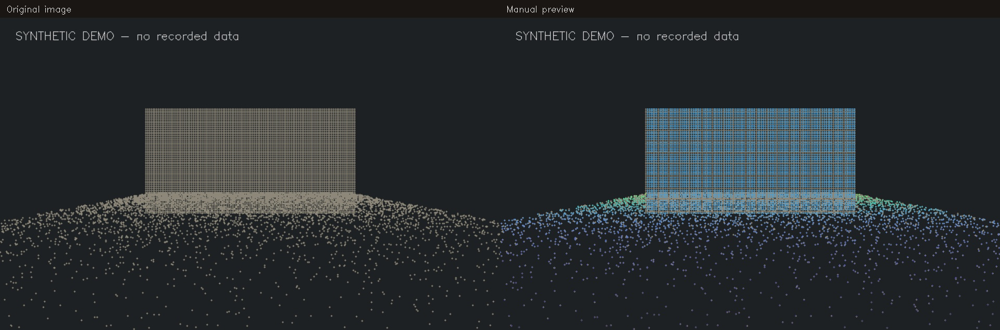

# Manual LiDAR–camera calibration web tool

A local browser tool for manually inspecting and adjusting camera-to-LiDAR
calibration. Edit XYZ, roll/pitch/yaw and camera intrinsics while viewing projected
point clouds over camera images. No ROS installation, frontend build or cloud
service is required to run the viewer.



## Quick start

Requires Python 3.10 or newer. FFmpeg is optional and enables MP4 export.

```bash
git clone https://github.com/emmeyteja/manual-lidar-camera-calibration-web.git
cd manual-lidar-camera-calibration-web
python3 -m venv .venv
source .venv/bin/activate
pip install .
manual-calibration demo --output ./demo
manual-calibration serve --project ./demo/project.json
```

Open **http://127.0.0.1:8765**. The demo is generated entirely from synthetic
geometry and images. It does not contain real recordings or vehicle calibration.
Use `--port 8766` to run alongside another viewer.

## What you can do

- Select cameras and recordings. Each camera's current edits carry across
  recordings in the same reference frame, making comparisons easier.
- Adjust camera XYZ in metres and fixed-axis XYZ roll, pitch, yaw in degrees.
- Edit `plumb_bob` or fisheye/equidistant intrinsics. Switching lens models clears
  distortion coefficients; supply coefficients calibrated for the new model.
- Compare original image/overlay, baseline/edited overlay, or overlay alone.
- Change point opacity and spacing. Display thinning retains the nearest point
  in each display cell; it does not alter the stored cloud.
- Download calibration JSON, save the current overlay image, or export MP4 with
  the current settings and a settings/frame-selection JSON sidecar.
- Use **Space** to play/pause, **P** for previous, and **N** for next. Shortcuts
  ignore text inputs, modifier keys and held-key repeats.

The tool displays the supplied images unchanged and applies distortion to the
projected points. Match intrinsics to the image stream's resolution and any
upstream lens correction. Do not apply distortion again to an already rectified
image; use that stream's rectified intrinsics and zero distortion instead.

## Your own images and point clouds

Create a directory containing `project.json`, camera images readable by OpenCV,
and NumPy `.npy` point clouds with numeric shape `N × 3` (XYZ) or `N × 4`
(XYZ/intensity; intensity is ignored). `np.save("cloud.npy", xyz)` writes a cloud.
Pickled NumPy objects are not accepted. Point colours indicate camera depth.

Start from [`examples/bag-config.json`](examples/bag-config.json), which contains
synthetic example mounts and intrinsics. A complete portable project adds:

```json
{
  "version": 1,
  "reference_frame": "base_link",
  "cameras": [{
    "id": "camera",
    "frame": "camera_body",
    "camera_mount": {"x": 0, "y": 0, "z": 1.5, "roll": 0, "pitch": 0, "yaw": 0},
    "intrinsics": {
      "camera_model": "plumb_bob",
      "fx_fy_cx_cy": [500, 500, 400, 250],
      "distortion": [0, 0, 0, 0, 0]
    }
  }],
  "lidars": [{
    "id": "lidar",
    "frame": "lidar",
    "mount": {"x": 0, "y": 0, "z": 0, "roll": 0, "pitch": 0, "yaw": 0}
  }],
  "recordings": [{
    "id": "recording",
    "label": "My recording",
    "fps": 10,
    "frames": {
      "camera": [{
        "image": "images/0000.png",
        "image_stamp_ns": 1000000000,
        "clouds": {
          "lidar": {"path": "clouds/0000.npy", "stamp_ns": 1000000000}
        }
      }]
    }
  }]
}
```

The numbers above are illustrative, for an 800 × 500 image. Replace them with
your own sensor values or inspect the generated demo's complete `project.json`.
IDs are strings containing letters, digits, `_` or `-`.
Each frame must include every configured LiDAR. Each recording must provide
frames for every configured camera, with strictly increasing image timestamps.
Paths are relative to `project.json` and must stay within its directory, including
after resolving symbolic links. Combine multiple recordings in the `recordings`
array; no fixed number of cameras or LiDARs is assumed.

Each LiDAR's `mount` transforms its input XYZ into `reference_frame` exactly once.
Already merged reference-frame clouds should be represented as one LiDAR with
an identity mount. LiDAR mounts stay fixed while camera values are edited.

## Import a ROS bag without ROS

```bash
pip install '.[bags]'
manual-calibration import-bag \
  --bag /path/to/rosbag_directory \
  --config ./examples/bag-config.json \
  --output ./data/my-recording \
  --max-frames 120 --tolerance-ms 50
manual-calibration serve --project ./data/my-recording/project.json
```

Edit the example's topic names, frames, mounts and intrinsics for your sensors
before importing. The importer uses the independent
[Rosbags reader](https://ternaris.gitlab.io/rosbags/topics/highlevel.html), which
supports ROS1 bags and ROS2 SQLite3/MCAP recordings. For ROS2, pass the bag
directory containing its metadata; a standalone MCAP file is also supported by
the reader. Standard `sensor_msgs/PointCloud2`, `Image` and `CompressedImage`
messages are supported. Raw vendor LiDAR packet messages must first be decoded
with the appropriate driver and sensor correction file.

Both import passes open source bags read-only. The importer indexes timestamps,
samples at most `--max-frames` images per camera across the usable recording,
then saves only the selected images/clouds. It uses the nearest LiDAR message
within `--tolerance-ms` for every configured sensor; unmatched images are skipped.
It refuses to replace an existing output directory.

Synchronization uses message **header timestamps**. Optional `time_offset_ms`
on a sensor shifts its timestamp before matching; positive means later. The
importer does not estimate clock offsets or scan midpoints automatically.
Optional `message_frame` checks the recorded header frame independently of the
camera body's `frame`. A LiDAR's `frame`, if supplied, is checked against its
PointCloud2 header. Topic and frame names are configurable.

## Transform conventions and exports

- Mounts are **sensor body → reference frame** transforms.
- Rotation is `Rz(yaw) @ Ry(pitch) @ Rx(roll)`, with angles in degrees.
- Optical coordinates are X right, Y down, Z forward. The default conversion
  assumes a camera body with X forward, Y left, Z up. A camera can supply a
  different proper 3×3 `body_to_optical` rotation. Use identity when the supplied
  camera mount already refers to the optical frame.
- Projection is `T_optical_from_body @ inverse(T_reference_from_camera_body)`
  applied to the reference-frame cloud.
- JSON exports include both transform directions and an inverse
  `[x, y, z, qx, qy, qz, qw]` vector, with explicit frame conventions.

Downloads are manual previews, not independently validated calibrations. Loading
JSON requires matching camera and reference frames. Original source files and
ROS TF are never updated. Check fixed objects at different depths, in several
recordings, before applying values in a separate deployment process.

## Timing and limitations

This is a **manual spatial overlay tool**, not an automatic calibration solver,
temporal calibrator or motion compensator. Each frame uses one image and one
scan per LiDAR. Time offsets are displayed. No per-point deskew or compensation
between sensors is applied. Moving scenes can therefore look misaligned even
with correct extrinsics; stationary scenes help isolate spatial alignment.
Visual overlap alone does not establish measurement accuracy.

The browser timeline steps through sampled images; interactive playback is a
review convenience rather than a real-time player. Video exports resample by
acquisition time at the recording's `fps` (default 10), repeating nearby frames
as needed to preserve elapsed time. Exports are limited to 36,000 output frames.

The server binds only to `127.0.0.1`. Keep it local; it is not a multi-user hosted
service. It uses a per-session request token, validates the Host header, and
allows browser edits only to calibration/display settings. No arbitrary browser
paths, telemetry, remote assets or uploads are used. Do not commit imported
datasets, exported values or real recording imagery to a public repository.

## Development

```bash
pip install -e '.[dev,bags]'
ruff check .
ruff format --check .
pytest
python -m build
npm ci
npm test
npm run format:check
```

Node.js 18 or newer is needed only for frontend development checks, not to run
the tool. Use an isolated virtual environment; on ROS workstations, inherited
`PYTHONPATH` and third-party pytest plugins can affect test collection. A clean
test invocation is `env -u PYTHONPATH PYTEST_DISABLE_PLUGIN_AUTOLOAD=1 pytest`.

HTTP, geometric, lens-model, read-only dataset, bag-import and FFmpeg tests use
synthetic fixtures. Tests skip optional bag/video checks if their dependencies
are unavailable. The repository includes no vendored dependency code. Runtime
dependencies retain their own licenses; see their upstream packages.

MIT licensed. Contributions welcome; keep datasets and private configurations
outside source control.
